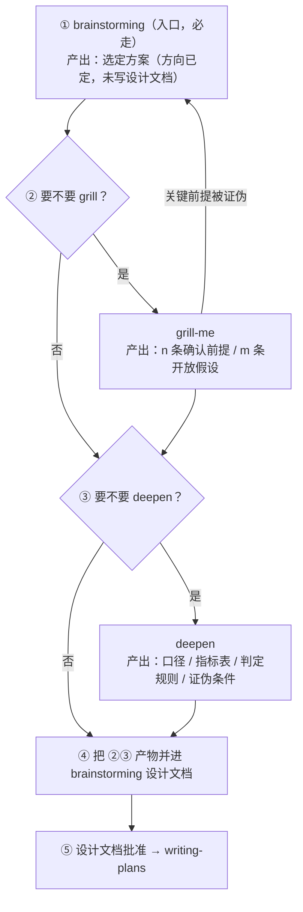

## skill分工

- brainstorming：做不做、做哪个方向（1→N→选 1）
- grill-me：这个方向真的站得住吗（N→1，前提压测）
- deepen：这个方向怎么做到专家级可落地（1→深，同维度下钻）

## 推荐的工作流

## 判断依据

### 要不要 grill

| 命中任一即加 grill | 不加 grill |
|---|---|
| 说得出「要做 X」，但说不出「为什么不是 Y」 | 方向还没定，选型还在 A/B 之间纠结 |
| 有不可逆成本：删库、改 schema、花钱、对外承诺 | 无未决取舍的明确小改动 |
| 方案里出现「应该没问题」「一般来说」「先这样」 | 简单 bug、查报错、无争议 PRD |
| 多个约束互相冲突且没排优先级 | |

> 方向未定时不调 grill：它在退场信号里就写了这种情况踢回 brainstorming。

### 要不要 deepen

| 加 deepen | 不加 deepen |
|---|---|
| 方案要落到「看哪份数据、哪个字段、什么口径、什么阈值、什么判据」才算完整 | 方案本身已是明确小改动，没有未决取舍 |
| 需要证据分级、可指认出处、指标表和证伪条件 | 简单 bug、查报错、无争议 PRD |
| 方案目前只是笼统描述，执行者还得自己猜 | 需要的是「扩面」（更多场景/维度/使用方），交回 brainstorming |

## 三条路径，按任务重量选

| 路径 | 适用 | 走哪几步 |
|---|---|---|
| **轻量** | 信息齐全、明确的小改动 | ① → ⑤ |
| **标准** | 有真实取舍、方向能定但前提没验过 | ① → ②grill → ④ → ⑤ |
| **重** | 有不可逆成本，且要交付专家级可执行方案 | ① → ②grill → ③deepen → ④ → ⑤ |

## 异常回路

| 情况 | 处理 |
|---|---|
| grill 证伪根节点 | 撤销选定方案，回 ① 重新列方案，不接受「降级继续」 |
| deepen 发现要扩面 | 停，交回 brainstorming 决定「要不要加这个面」 |
| deepen 挖出 grill 没问到的未验证前提 | 补跑一轮 grill，不必重排主序 |

## 速查

> 方向没定 → 只走 brainstorming。
> 方向定了、怕前提虚 → 加 grill（在写设计文档前）。
> 方向定了、前提硬、但方案太笼统无法执行 → 加 deepen。
> 两者都要 → **grill 在前，deepen 在后**，产物一起并进设计文档再批准。
